<picture>
  <source media="(prefers-color-scheme: dark)" srcset="assets/hero-dark.svg">
  <source media="(prefers-color-scheme: light)" srcset="assets/hero-light.svg">
  
</picture>

  <a href="https://shenmareparas.tech" target="_blank" rel="noopener noreferrer">Website ↗</a>&nbsp;&nbsp;·&nbsp;&nbsp;
  <a href="https://www.linkedin.com/in/parasshenmare/" target="_blank" rel="noopener noreferrer">LinkedIn ↗</a>&nbsp;&nbsp;·&nbsp;&nbsp;
  <a href="https://x.com/parasshenmare" target="_blank" rel="noopener noreferrer">X (Twitter) ↗</a>&nbsp;&nbsp;·&nbsp;&nbsp;
  <a href="https://github.com/shenmareparas?tab=repositories" target="_blank" rel="noopener noreferrer">All repositories ↗</a>

Software developer specializing in mobile architecture, modern web engineering, and system-level applications. I design responsive cross-platform apps with Flutter and Dart, craft high-performance web applications with Next.js and React, and build native desktop utilities with Swift.

Focused on fluid gesture physics, resilient client-side state machines, and clean systems programming.

### Selected work

| Project | What it does | Built with |
| :--- | :--- | :--- |
| **<a href="https://github.com/shenmareparas/Chess" target="_blank" rel="noopener noreferrer">Chess ↗</a>** | Feature-rich chess game with custom piece animations, move validation, and native Stockfish engine integration. | Flutter · Dart · Flame Engine |
| **<a href="https://shenmareparas.tech" target="_blank" rel="noopener noreferrer">Portfolio_NextJS ↗</a>** | Modern high-performance web app with 3D Coverflow carousel, gesture lightbox, and mobile haptics. | Next.js 16 · React 19 · TypeScript |
| **<a href="https://github.com/shenmareparas/live-wallpaper" target="_blank" rel="noopener noreferrer">Live Wallpaper ↗</a>** | Native macOS dynamic wallpaper engine with hardware-accelerated HEVC playback and gapless looping. | Swift · SwiftUI · AppKit |
| **<a href="https://github.com/shenmareparas/VIT_Bhopal_Mess" target="_blank" rel="noopener noreferrer">VIT Bhopal Mess ↗</a>** | Real-time university mess guide with automated meal schedules, menu pricing, and fast food lookup. | Flutter · Dart · REST APIs |
| **<a href="https://github.com/shenmareparas/expense_tracker" target="_blank" rel="noopener noreferrer">Expense Tracker ↗</a>** | Modern personal finance and split-bill app featuring 6 split modes, real-time analytics with fl_chart, and PDF exports. | Flutter · Dart · Supabase |
| **<a href="https://github.com/shenmareparas/CodeLens-AI" target="_blank" rel="noopener noreferrer">CodeLens-AI ↗</a>** | Full-stack repository intelligence copilot that audits codebases, maps AST complexity, and synthesizes dossiers. | Gemini · React 19 · .NET |
| **<a href="https://github.com/shenmareparas/nexu5-music-bot" target="_blank" rel="noopener noreferrer">nexu5-music-bot ↗</a>** | High-performance Discord music bot featuring low-latency voice streaming, queue management, and rich audio playback. | Bun · Discord.js · yt-dlp |

<picture>
  <source media="(prefers-color-scheme: dark)" srcset="assets/activity-dark.svg">
  <source media="(prefers-color-scheme: light)" srcset="assets/activity-light.svg">
  
</picture>
