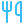

  <!-- Banner Header -->
  

  <!-- Quick Presence Badges -->
  
  
  
  

 

---

###  About Me

I am a passionate **Software Developer** dedicated to crafting intuitive, performant, and visually stunning digital experiences. Specializing in **mobile architecture (Flutter, Android, iOS)** and modern **full-stack web development (Next.js 16, React 19, TypeScript)**, I bridge the gap between robust software engineering and pixel-perfect design aesthetics.

-  **Mobile Specialization:** High-performance cross-platform & native engineering with **Flutter & Dart**, **Android (Kotlin)**, and **iOS/macOS (Swift & SwiftUI)**.
-  **Modern Web Engineering:** Sub-second LCP architectures using **Next.js 16 (App Router)**, **React 19**, **Tailwind CSS v4**, and **Bun**. Certified **100/100 React Doctor audit** score for lifecycle purity and render performance.
-  **UI/UX & Motion Craft:** Obsessed with micro-interactions, fluid gesture physics, haptic feedback, 3D perspective transforms, and dark/light adaptive glassmorphic design systems.
-  **Systems & Games:** Experience with game engine architecture using **Flame Engine**, native macOS windowing with **AppKit**, and scalable state management.
-  **Ask Me About:** Flutter architecture (Bloc / Riverpod / State Machines), Flame game development, Next.js optimization, or mobile gesture systems.
-  **Core Philosophy:** I believe animations should feel organic—if it doesn't move with natural spring physics, it's not finished!

---

###  Tech Arsenal

| Domain | Technologies & Frameworks |
| :--- | :--- |
|  **Mobile & Native** | **Flutter**, **Dart**, **Android**, **iOS**, **Swift**, **SwiftUI**, **Kotlin**, **Flame Engine** |
|  **Web & Frontend** | **Next.js 16**, **React 19**, **TypeScript**, **JavaScript**, **Tailwind CSS v4**, **HTML5**, **CSS3**, **Framer Motion** |
|  **Backend & BaaS** | **Node.js**, **Express**, **Firebase**, **Supabase**, **RESTful APIs** |
|  **Tools & Platforms** | **Antigravity**, **Claude Code**, **Git**, **GitHub**, **Android Studio**, **Xcode**, **VS Code**, **Postman**, **Figma**, **Vercel**, **Bun** |

 

  &nbsp;&nbsp;
   
  

---

###  Featured Projects

| Project | Description | Tech Stack | Links |
| :--- | :--- | :--- | :--- |
|  **Chess Engine & Game** | Feature rich 2-player and singleplayer chess app with custom piece animations, move validation, and native Stockfish engine integration. | `Flutter` `Dart` `Flame Engine` | [GitHub (32 Stars)](https://github.com/shenmareparas/Chess) |
|  **Portfolio Web App** | Modern high-performance portfolio featuring 3D Coverflow carousel, gesture-driven lightbox, mobile haptics, and a certified 100/100 React Doctor score. | `Next.js 16` `React 19` `Tailwind v4` `TypeScript` | [Live Demo](https://shenmareparas.tech) • [Source Code](https://github.com/shenmareparas/Portfolio_NextJS) |
|  **Live Wallpaper Engine** | Native macOS dynamic desktop & lock screen wallpaper engine with hardware-accelerated HEVC playback and gapless looping. | `Swift` `SwiftUI` `macOS` `AppKit` | [Source Code](https://github.com/shenmareparas/live-wallpaper) |
|  **VIT Bhopal Mess** | Real-time mess & canteen food guide for university students with automated time-based meal tracking, price calculation, and quick search. | `Flutter` `Dart` `JavaScript` `REST APIs` | [Web Demo](https://vitbmessdemo.vercel.app) • [Source Code](https://github.com/shenmareparas/VIT_Bhopal_Mess) |
|  **Expense Tracker** | Modern personal finance and split-bill app featuring 6 split modes, real-time analytics with fl_chart, Supabase Auth/DB, and PDF statement exports. | `Flutter` `Dart` `Supabase` `Provider` | [Source Code](https://github.com/shenmareparas/expense_tracker) |

---

###  GitHub Analytics

  

    

  <table border="0">
    <tr>
      <td align="center" valign="middle">
        
      </td>
      <td align="center" valign="middle">
        
      </td>
    </tr>
    <tr>
      <td colspan="2" align="center">
        
      </td>
    </tr>
  </table>

---

###  Connect & Collaborate

Whether you're looking to build an ambitious mobile application, optimize web performance, or discuss innovative ideas—feel free to reach out!

  
  
  

<!-- Footer Banner Wave -->

